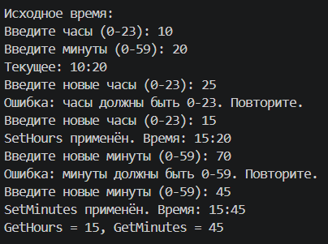
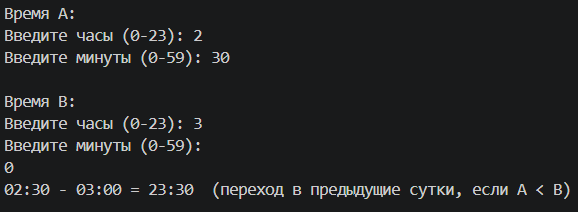
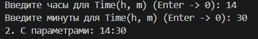
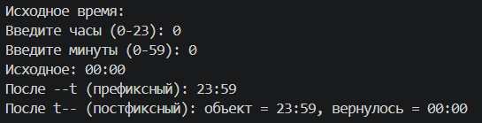
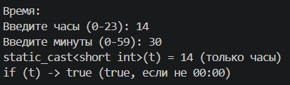
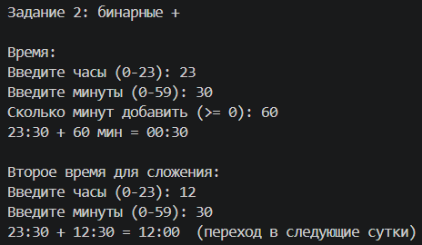

Суворова Полина, Группа ЛА-1, Лабораторная №4

---

# Задание 1

## Определение класса Time

### Текст задачи

Реализовать класс `Time` с полями `hours`, `minutes` (short int).
Конструкторы (не менее трёх): по умолчанию, с параметрами, копирования.
Свойства (геттеры/сеттеры), перегрузка `operator<<` для вывода полей,
метод `Subtract` - вычитание времени с переходом в предыдущие сутки.

### Алгоритм решения

1. Поля `hours_`, `minutes_` - private.
2. Конструктор по умолчанию - `00:00`.
3. Конструктор с параметрами - корректировка через
   `((v % limit) + limit) % limit`: `25 -> 1`, `70 -> 10`, `-1 -> 23`.
4. Конструктор копирования - копирует поля.
5. Геттеры `GetHours`, `GetMinutes` - `const`.
6. Сеттеры `SetHours`, `SetMinutes` - возвращают `bool`, проверяют диапазон.
7. `Subtract`: перевод в минуты, вычитание, при `< 0` += 1440, обратно.
8. `operator<<` - друг, формат `HH:MM` с ведущими нулями.

### Тестирование

**Ввод:**
- часы по умолчанию - Enter (пусто -> 0);
- минуты по умолчанию - Enter (пусто -> 0);
- часы для `Time(h, m)` - `14`;
- минуты для `Time(h, m)` - `30`.

**Вывод:**

- По умолчанию: 00:00
- С параметрами: 14:30
- Копирования (копия t2): 14:30

## Свойства (геттеры и сеттеры)

### Текст задачи

Реализовать `GetHours`, `GetMinutes`, `SetHours`, `SetMinutes`
с проверкой диапазона.

### Алгоритм решения

1. Геттеры возвращают поля (`const`).
2. Сеттеры проверяют `0-23` / `0-59`.
3. При успехе - меняют поле и возвращают `true`, иначе `false`.

### Тестирование

**Ввод:**
- `10:20`;
- новые часы `25` -> ошибка -> `15`;
- новые минуты `70` -> ошибка -> `45`.

**Вывод:**

**Проверка:** сеттеры отклоняют неверные значения, принимают корректные;
геттеры возвращают актуальные.

## Метод Subtract

### Текст задачи

Вычитание времени из времени с переходом в предыдущие сутки.
Результат - типа `Time`.

### Алгоритм решения

1. `total_a = hours_ * 60 + minutes_`, `total_b = other.hours_ * 60 + other.minutes_`.
2. `diff = total_a - total_b`.
3. Если `diff < 0` - `diff += 1440` (переход в предыдущие сутки).
4. `hours = diff / 60`, `minutes = diff % 60`.

### Тестирование

**Ввод:** A = `02:30`, B = `03:00`.

**Вывод:**

02:30 - 03:00 = 23:30 (переход в предыдущие сутки, если A < B)

**Проверка:** переход в предыдущие сутки корректен.

## friend operator<<

### Текст задачи

Перегрузка вывода для полей класса в формате `HH:MM`.

### Алгоритм решения

1. Друг класса, доступ к `hours_`, `minutes_`.
2. Вывод с ведущими нулями (если `< 10`, печатаем `0`).

### Тестирование

**Ввод:** время `14:30`.

**Вывод:** `14:30` (для `< 10` - `09:05`).

**Проверка:** формат `HH:MM` соблюдается, друг имеет доступ к private полям.

# Задание 2

## Унарный --

### Текст задачи

Префиксный и постфиксный `--` - вычитание одной минуты с переходом
в предыдущие сутки.

### Алгоритм решения

1. `total = hours_ * 60 + minutes_ - 1`.
2. `total = Normalize(total, 1440)`.
3. `hours_ = total / 60`, `minutes_ = total % 60`.
4. Постфиксный: сохранить копию, вызвать префиксный, вернуть копию.

### Тестирование

**Ввод:** `00:00`.

**Вывод:**

**Проверка:** префиксный и постфиксный `--` работают, переход корректен.

## Приведение типа

### Текст задачи

- `explicit operator short int()` - явное, возвращает часы.
- `operator bool()` - неявное, `true`, если не `00:00`.

### Алгоритм решения

1. Явное: `return hours_;`.
2. Неявное: `return hours_ != 0 || minutes_ != 0;`.

### Тестирование

**Ввод:** `14:30`.

**Вывод:**

**Проверка:** явное приведение даёт только часы, неявное `bool` корректно.
Для `00:00` было бы `0` и `false`.

## Бинарные +

### Текст задачи

- `operator+(unsigned int)` - добавить минуты.
- `operator+(const Time&)` - сложить два времени.

### Алгоритм решения

1. `total = hours_ * 60 + minutes_ + minutes` (или сумма двух времён).
2. `total = Normalize(total, 1440)` (переход в следующие сутки).
3. `return Time(total / 60, total % 60);`.

### Тестирование

**Ввод:** `23:30` + `60` мин; `23:30` + `12:30`.

**Вывод:**

**Проверка:** оба `operator+` работают, переход через сутки корректен.